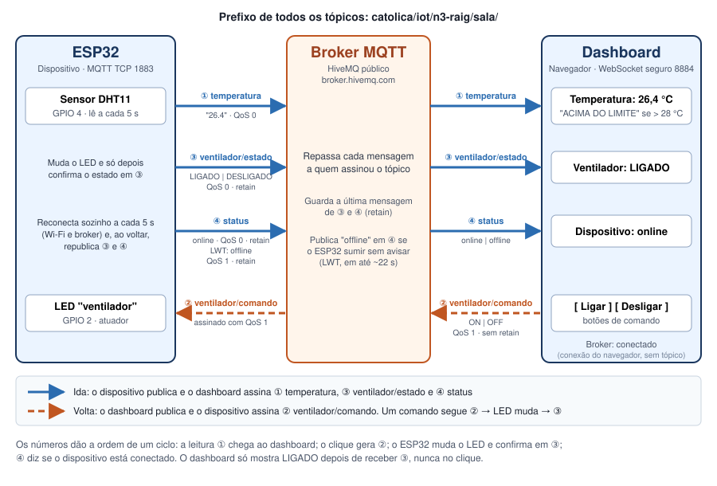

# Monitor de Temperatura da Sala

N3 de Internet das Coisas · Engenharia de Software, Católica SC.
Equipe: Renato Colin Neto · Adrian Cesar Gonçalves · Gabriel Carvalho · Igor Thiago Seberino.

Plano e requisitos: [`docs/plano/00-visao-geral.md`](docs/plano/00-visao-geral.md) ·
tarefas: [Project @sala](https://github.com/users/igorSeberino/projects/3) ·
registro de IA: [`docs/registro-ia.md`](docs/registro-ia.md)

## 1. Uso escolhido

Um ESP32 mede a temperatura de uma sala a cada 5 segundos e publica a leitura por MQTT. O
dashboard mostra o valor em tempo real e exibe o aviso **"ACIMA DO LIMITE"** quando a
temperatura passa de **28 °C**. Pelo dashboard, a pessoa liga ou desliga um LED que representa o
ventilador da sala, e a página mostra o estado em texto: **LIGADO** ou **DESLIGADO**.

Escolhemos esse uso porque é simples de montar, só usa o que vimos nas aulas e cobre os quatro
critérios da nota: caminho completo (leitura indo e comando voltando pelo broker), dispositivo
(lê, aciona e reconecta sozinho), dashboard (leitura e estado em texto, botão de comando) e
documentação.

## 2. Componentes

| Parte | O que usamos | Observação |
|---|---|---|
| Dispositivo | ESP32 DevKit | Programado na Arduino IDE, biblioteca MQTT `PubSubClient` (Nick O'Leary) |
| Sensor | DHT11, pino de dados no **GPIO 4** | Biblioteca `DHT sensor library` (Adafruit) |
| Atuador | LED + resistor de 220 Ω no **GPIO 2** | Representa o ventilador |
| Broker | HiveMQ público: `broker.hivemq.com` | Porta 1883 (ESP32) e 8884 com WebSocket seguro, caminho `/mqtt` (navegador) |
| Dashboard | Uma página HTML + JavaScript com a biblioteca MQTT.js | Abre direto no navegador, sem servidor próprio |

**Por que esse broker:** é público e gratuito, então ninguém precisa instalar nada; aceita ao
mesmo tempo TCP (ESP32) e WebSocket seguro (navegador), e qualquer pessoa da equipe testa de
casa. Em 28/10 testamos o `test.mosquitto.org` (o Mosquitto das aulas, hospedado) e ele não
respondeu nem na 1883 nem na 8081; o próprio site avisa que WebSocket e TLS são o que mais fica
fora do ar. O HiveMQ passou no mesmo teste: leitura, comando, retain e Last Will. Se o HiveMQ
cair, o Mosquitto volta a ser opção só trocando o endereço na configuração. Como o broker é
público, usamos um prefixo de tópico próprio da equipe e não enviamos nenhum dado sensível.

## 3. Tópicos MQTT

Prefixo de todos os tópicos: `catolica/iot/n3-raig/sala/` (iniciais da equipe, para não colidir
com outros grupos no broker público).

| Tópico | Quem publica → quem assina | Mensagem | QoS / retain |
|---|---|---|---|
| `…/sala/temperatura` | ESP32 → Dashboard | número em °C, a cada 5 s: `26.4` | 0 / não |
| `…/sala/ventilador/comando` | Dashboard → ESP32 | `ON` ou `OFF` | 1 / não |
| `…/sala/ventilador/estado` | ESP32 → Dashboard | `LIGADO` ou `DESLIGADO` | 0 / sim |
| `…/sala/status` | ESP32 (e o broker, pelo Last Will) → Dashboard | `online` ou `offline` | `online`: 0 / sim · `offline` (Last Will): 1 / sim |

- **Comando e estado são separados.** O dashboard não "chuta" que o LED ligou: ele só mostra
  LIGADO quando o próprio ESP32 confirma no tópico de estado, e o ESP32 só confirma depois de
  mudar o pino.
- **Comando sem retain.** Um comando antigo não pode ser executado de novo quando o ESP32
  reconecta.
- **Retain no estado e no status.** Quem abre o dashboard depois já recebe o último estado, sem
  esperar a próxima mudança.
- **Last Will (testamento) em `status`.** Ao conectar, o ESP32 registra no broker a mensagem
  `offline`. Se o Wi-Fi ou a energia do ESP32 cair, o broker percebe pelo keep alive
  (15 s × 1,5 ≈ 22 s) e publica `offline` sozinho; o dashboard mostra "Dispositivo
  desconectado".
- **QoS do ESP32.** A `PubSubClient` só publica com QoS 0 (assina com QoS 0 ou 1). Por isso o
  ESP32 publica com QoS 0 e assina o comando com QoS 1; o Last Will vai com QoS 1, porque quem
  publica é o broker.

## 4. Diagrama do sistema

## 5. Ligação do circuito

| De | Para | Observação |
|---|---|---|
| DHT11 VCC | ESP32 3V3 | Não usar 5 V: o pull-up do módulo levaria 5 V ao GPIO, e o ESP32 é 3,3 V |
| DHT11 DATA | ESP32 GPIO 4 | O módulo de 3 pinos já tem o resistor de pull-up |
| DHT11 GND | ESP32 GND | |
| ESP32 GPIO 2 | Resistor 220 Ω → LED (+, perna longa) | GPIO 2 também acende o LED azul da placa |
| LED (−, perna curta) | ESP32 GND | |

O GPIO 2 é pino de boot (strapping): precisa estar em nível baixo ou solto na energização. O LED
com resistor para o GND mantém o pino em nível baixo, então a placa liga e grava normalmente.

## 6. Caminho de cada mensagem

| Fluxo | Passo a passo |
|---|---|
| Leitura | DHT11 mede → ESP32 publica em `temperatura` → broker repassa → dashboard atualiza o número e mostra o aviso se passar de 28 °C. |
| Comando | Usuário clica em "Ligar" → dashboard publica `ON` em `ventilador/comando` → broker repassa → ESP32 acende o LED → ESP32 publica `LIGADO` em `ventilador/estado` → dashboard mostra "Ventilador: LIGADO". |
| Queda do ESP32 (Wi-Fi ou energia) | O broker para de receber o keep alive → publica `offline` em `status` (Last Will) → dashboard mostra "Dispositivo desconectado". O ESP32 tenta reconectar a cada 5 s e, ao voltar, publica `online` e o estado atual do LED e assina de novo o tópico de comando. |
| Queda do broker | O ESP32 e o dashboard perdem a conexão. O dashboard mostra "Broker: desconectado" (o Last Will não chega, porque quem publica é o broker). Os dois tentam reconectar sozinhos e, quando o broker volta, o ESP32 republica `online` e o estado. |

## 7. Equipe

| Integrante | GitHub | Responsabilidade principal |
|---|---|---|
| Renato Colin Neto | [@rcolinneto](https://github.com/rcolinneto) | Dashboard (HTML + MQTT.js): leitura, aviso de limite, estado em texto e botões |
| Adrian Cesar Gonçalves | [@adrian-cesar](https://github.com/adrian-cesar) | Montagem do circuito e leitura do DHT11 no ESP32 |
| Gabriel Carvalho | [@gabrielcarvallho](https://github.com/gabrielcarvallho) | Código MQTT do ESP32: publicação, comando do LED, reconexão e Last Will |
| Igor Thiago Seberino | [@igorSeberino](https://github.com/igorSeberino) | Diagrama, passo a passo, configuração de exemplo, testes de queda, vídeo e registro de IA |

Todos revisam o código inteiro antes da apresentação, por causa das perguntas do professor.
